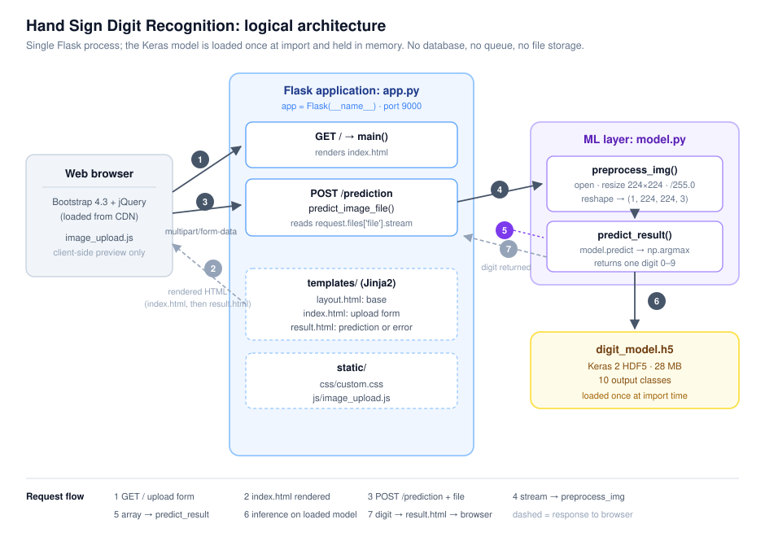
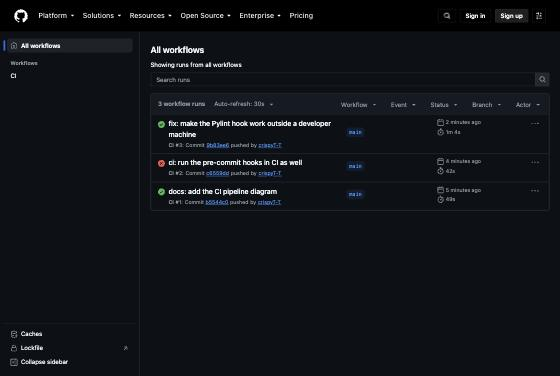
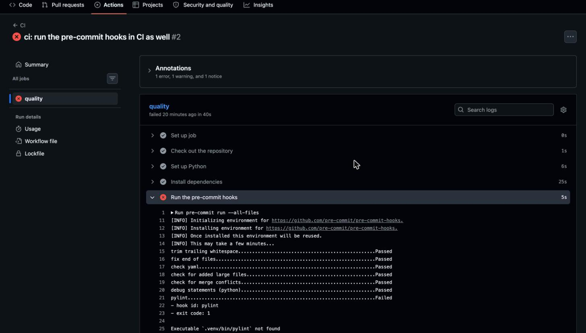
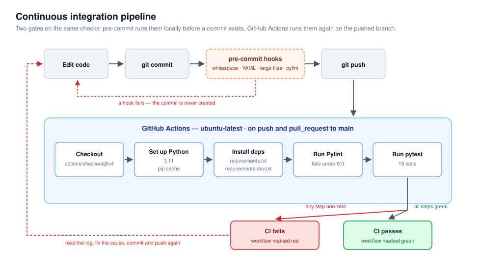

# Assignment 2 — Software Quality III: Build and Release (CSCN73010)

## 1. GitHub repository

<https://github.com/crispyT-T/Flask_Image_Recognition>

Forked from [Sachin-crypto/Flask_Image_Recognition](https://github.com/Sachin-crypto/Flask_Image_Recognition)
and based on commit `62d8114` ("Added dl model", 29 April 2023) — the last commit holding
only the legacy application. Later upstream commits already contained a completed version
of this assignment by another student, so they are not part of this branch.

---

## 2. Steps to set up and run the application

Requires Python 3.11.

```bash
git clone https://github.com/crispyT-T/Flask_Image_Recognition.git
cd Flask_Image_Recognition
python3.11 -m venv .venv
source .venv/bin/activate
pip install -r requirements.txt
python app.py
```

The application serves on <http://127.0.0.1:9000>. Choosing an image from `test_images/`
and submitting it returns the predicted digit.

### Installation problems encountered

**The pinned dependencies could not be installed.** `requirements.txt` specified
`tensorflow==2.10.0`, which failed on Apple Silicon:

```
ERROR: Could not find a version that satisfies the requirement tensorflow==2.10.0
       (from versions: 2.13.0rc0, ... 2.22.0rc0)
ERROR: No matching distribution found for tensorflow==2.10.0
```

TensorFlow 2.10 predates the arm64 macOS wheels published under the `tensorflow` name, so
no distribution exists for the platform. Resolved by moving to TensorFlow **2.15.1**, the
newest release that still bundles Keras 2 — a necessary constraint, because the saved
model is a Keras 2 HDF5 file and Keras 3 (TensorFlow 2.16 and later) will not load that
format without the `tf-keras` shim. NumPy was held at 1.26.4 because TensorFlow 2.15 is
not built against NumPy 2, and Werkzeug below 3.0 because Flask 2.2 imports symbols that
Werkzeug 3 removed.

**The model path was hardcoded to the original author's machine.** `model.py` contained
`load_model("D:/SACHIN/Models/Hand-Sign-Digit-Language/digit_model.h5")`, so importing the
module raised `OSError` on any other computer. Since `digit_model.h5` is committed at the
repository root, the path is now resolved relative to the module file:

```python
MODEL_PATH = os.path.join(os.path.dirname(__file__), "digit_model.h5")
model = load_model(MODEL_PATH)
```

**Editor and cache files were tracked.** `.idea/` and `__pycache__/` were removed and a
`.gitignore` added.

---

## 3. Screenshots of the application running


**Figure 1.** The home page served at `http://127.0.0.1:9000/`.


**Figure 2.** An image selected. `static/js/image_upload.js` previews it client-side and
writes the file name into the label; nothing has reached the server yet.


**Figure 3.** The result page. A hand sign for 4 returns `4`.

---

## 4. Main application components

| File | Purpose |
| --- | --- |
| `app.py` | Flask entry point. Creates the application and defines both routes: `/` serves the upload form, `/prediction` accepts the file and returns the digit. |
| `model.py` | Machine-learning layer. Loads the Keras model at import time; `preprocess_img` turns an upload into a model-ready array and `predict_result` runs inference. |
| `digit_model.h5` | The trained model: 28 MB, Keras 2 HDF5, ten output classes. |
| `templates/layout.html` | Jinja2 base template; loads Bootstrap 4.3 and jQuery from a CDN plus the project's own CSS and JavaScript. |
| `templates/index.html` | Upload page: a `multipart/form-data` form with a file input named `file`. |
| `templates/result.html` | Shows `predictions` on success, `err` on failure. |
| `static/css/custom.css` | Gradient background and upload-area styling. |
| `static/js/image_upload.js` | Client-side only: previews the chosen image and displays its name. |
| `test_images/` | 100 sample images, ten per digit. |

**Flask is configured** in `app.py` as `app = Flask(__name__)`, taking every default —
which is how `templates/` and `static/` are located. The port (9000) and debug flag are
set inside the `__main__` guard, so they apply only when the file is run directly.

**The model is loaded** in `model.py` at *module scope*, not inside a function. The whole
28 MB model is therefore read and the network built the moment anything imports `model` —
including `app.py` at startup and any test file. It is held in a module-level global that
`predict_result` closes over. Inference does not pay the loading cost per request, but the
module cannot be imported without the model present, which is what forces the test suite
to mock it.

**Images are preprocessed** in `preprocess_img`: open with Pillow, resize to 224×224,
scale from 0–255 down to 0–1, reshape into a batch of one. The parameter is named
`img_path` but `app.py` passes a file *stream*; Pillow accepts either.

**Templates and static resources** live at the Flask defaults, `templates/` and `static/`,
resolved relative to `app.py`.

**An upload becomes a prediction** as follows: the browser requests `GET /` and `main()`
renders `index.html`; the user picks a file, previewed locally by `image_upload.js`;
submitting posts `multipart/form-data` to `POST /prediction`; `predict_image_file()`
passes `request.files['file'].stream` to `preprocess_img`, which returns a
`(1, 224, 224, 3)` array; `predict_result` calls `model.predict` and `np.argmax` reduces
ten class probabilities to one digit; the digit is rendered into `result.html`. If any of
that raises, the error page is rendered instead.

---

## 5. Architecture diagram



One Flask process holding the model in memory, serving a browser over HTTP. No database,
no queue, no separate model server, no persistence — the uploaded file is read from the
request stream and never written to disk.

---

## 6. Pylint configuration and code-quality improvements

### Configuration

`.pylintrc` is deliberately short. The approach was to keep Pylint's defaults and fix what
it reported, rather than disable checks to raise the score.

| Setting | Value | Reasoning |
| --- | --- | --- |
| `ignored-modules` | `keras`, `tensorflow` | Both build much of their public API lazily at import time. Static analysis cannot see those attributes and reports false `no-member` errors. |
| `fail-under` | `9.0` | Pylint exits non-zero below this, so a regression fails the build instead of being merely reported. |
| `max-line-length` | `100` | Pylint 3's own default, stated explicitly rather than inherited silently. |

Only `duplicate-code` is disabled outright. Exactly one message is suppressed inline, in
`conftest.py`, with its reason beside it: `from app import app  # pylint: disable=import-outside-toplevel`.
Importing `app` at module scope would load the model before the patch replacing the loader
is active, which is the entire point of that fixture.

### Improvements made

The baseline scored **7.50/10**.

| Finding | Resolution |
| --- | --- |
| `C0114`, `C0116` — missing docstrings (six) | Added. `model.py`'s records that the model loads once per process; `preprocess_img`'s notes that it accepts a path *or* a stream, since the parameter name suggests otherwise. |
| `W0702` — bare `except:` | Replaced with `except (KeyError, OSError, ValueError)`, one per failure a bad upload actually produces, plus `app.logger.exception` so the cause reaches the log. The bare form also caught `KeyboardInterrupt` and `SystemExit`, so the server could not be interrupted cleanly during a request. |
| `R1710` — inconsistent returns | The body was wrapped in `if request.method == 'POST'`, which the route already guarantees. If it were ever false the view returned `None`, which Flask rejects. Removing the redundant check removed the path. |

Final score: **10.00/10**.

The score is the least useful signal Pylint produced. The six docstrings moved it most —
7.50 to 9.38 — and changed no behaviour whatsoever. The two findings that actually
mattered moved it least: the bare `except` was concealing the cause of every failure, and
the inconsistent return left a live path on which the view returned `None`. The score
moved least for the fixes that mattered most.

---

## 7. Pre-commit configuration

`.pre-commit-config.yaml`, installed with `pre-commit install`:

| Hook | Purpose |
| --- | --- |
| `trailing-whitespace`, `end-of-file-fixer` | Whitespace hygiene. The first run fixed missing end-of-file newlines in four templates and the stylesheet. |
| `check-yaml` | Validates the Actions workflow before it reaches CI. |
| `check-added-large-files` (`--maxkb=30720`) | Set just above `digit_model.h5` at 28 MB, so the model commits but nothing larger slips in. |
| `check-merge-conflict` | Blocks conflict markers. |
| `debug-statements` | Blocks a stray `breakpoint()` or `pdb` import. |
| `pylint` (local hook) | Runs Pylint from the active interpreter so it resolves Flask and Keras the way CI does. |

---

## 8. Pytest test cases

Nineteen tests across `tests/test_routes.py` and `tests/test_model.py`.

| Requirement | Tests |
| --- | --- |
| Home page accessible | `test_home_page_is_served` |
| Valid request → expected response | `test_valid_upload_returns_the_predicted_digit`, which also asserts the model received exactly one correctly shaped, normalised batch |
| Missing uploaded file | `test_missing_file_is_rejected` |
| Invalid or unexpected input | `test_non_image_upload_is_rejected`, `test_empty_filename_is_rejected`, `test_greyscale_image_is_rejected`, `test_get_is_not_allowed_on_the_prediction_route` |
| Preprocessing / prediction component | Nine tests covering shape, dtype, normalisation, path and stream inputs, and the argmax reduction |

**Edge cases.** 1×1 and 4000×10 images (extreme aspect ratios still resize to 224×224); an
image already 224×224 (the resize is a no-op); a greyscale image, which preprocesses to one
channel so the reshape to three raises `ValueError` and the application rejects it rather
than predicting from wrong data; an empty filename, which is what a browser sends when the
form is submitted with nothing chosen; a prediction that is not 4, pointing the stub at
class 9 to prove the result tracks the model rather than being hard-coded; and the stub
itself, checked to still resemble real model output.

**Mocking.** Because `model.py` loads the model at import, every run would otherwise pay
that cost before collection. `conftest.py` patches `keras.models.load_model` at module
import — before any test module imports `app` or `model` — so the application receives a
stub whose `predict` returns a fixed ten-class vector. The suite runs in **0.44 seconds**.
One test marked `slow` exercises the genuine model through a saved reference to the
unpatched loader, asserting a real sample of the digit 4 is classified as 4 with more than
50% confidence; it also asserts the fixture returned a real Keras object, since the stub
peaks at class 4 too and the test would otherwise pass either way.

---

## 9. Evidence of local Pylint and pytest execution

```
$ pylint app.py model.py conftest.py tests/

--------------------------------------------------------------------
Your code has been rated at 10.00/10 (previous run: 9.73/10, +0.27)
```

```
$ pytest
======================== test session starts =========================
collected 19 items

tests/test_model.py ............                                [ 63%]
tests/test_routes.py .......                                    [100%]

========================= 19 passed in 0.44s =========================
```

Raw output is committed under `docs/evidence/`, including the 7.50/10 baseline report and
the failing test run described in section 11.

---

## 10. GitHub Actions workflow runs

`.github/workflows/ci.yml` runs on every push and pull request to `main`: checkout, set up
Python 3.11 with a pip cache, install the application and development dependencies, run
the pre-commit hooks, run Pylint, run pytest. A green run completes in about 47 seconds.



**Figure 4.** Workflow runs. #1 passed, #2 failed, #3 passed after the fix.

---

## 11. A failed check and how it was corrected

Run **#2** failed. The commit added `pre-commit run --all-files` as a CI step, on the
reasoning that CI should not trust that local hooks had run. The step failed immediately:

```
pylint...................................................................Failed
- hook id: pylint
Executable `.venv/bin/pylint` not found
```



**Figure 5.** Run #2: the pre-commit step failed and the later steps were skipped.

The cause was a genuine defect in the pre-commit configuration. The Pylint hook was
declared with `entry: .venv/bin/pylint` — a path that exists only on a machine where
someone created a virtualenv in that exact location. A CI runner installs dependencies
into the interpreter `setup-python` provides and has no `.venv` at all. The hook had
worked locally for every commit until then, and nothing would have revealed the problem
except running it elsewhere, which is what CI is for.

The fix was to invoke the module rather than a path:

```yaml
entry: python -m pylint
```

That resolves to the activated virtualenv locally and to the runner's interpreter in CI,
so both see Flask and Keras and resolve imports identically. Run **#3** passed.

| Run | Commit | Result |
| --- | --- | --- |
| #1 | `807e663` docs: add the CI pipeline diagram | ✅ success |
| #2 | `7d154b6` ci: run the pre-commit hooks in CI as well | ❌ **failure** |
| #3 | `259f2c0` fix: make the Pylint hook work outside a developer machine | ✅ success |

---

## 12. CI pipeline diagram



The same checks run at two gates. Pre-commit runs them locally before a commit exists;
GitHub Actions runs them again on the pushed branch, because local hooks can be bypassed
with `--no-verify` and CI should not assume they ran.
